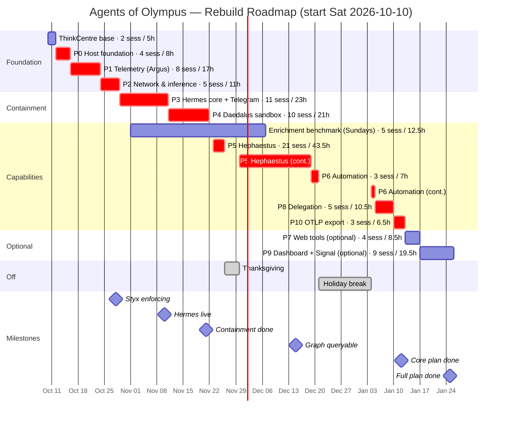

# AgentsOfOlympus
An AI Agent Orchestration Server Implementation

# Table of Contents
- [Purpose](#purpose)
- [Architecture](#architecture)
- [Roadmap](#roadmap)
- [Project Status](#project-status)
- [Contributing](#contributing)

# Purpose
An AI agent platform designed with a strong security posture. It can be designed to run on a homelab setup with more than one mini PC. One mini PC will hold the agents, while the other mini PC will serve as the observation node for the system's performance. 

# Architecture

The main orchestrator will be Hermes which is built by [Nous Research](https://github.com/NousResearch).

It will run as a containerized application.

The observation node lives on a separate device to allow a sandboxed monitoring method. It is not observable by the agent.

Communication with the agent orchestrator can be conducted through various interfaces such as Signal, Telegram, or Discord.

# Roadmap

The current roadmap is shown below. The in depth tasks are on this [document](/docs/Roadmap.md).

| Milestone | Date | Meaning |
|---|---|---|
| Styx enforcing | Wed Oct 28, 2026 | All egress forced through per-source allowlists |
| Hermes live | Tue Nov 10, 2026 | Hermes on Telegram with P3 gates passed |
| Containment done | Sat Nov 21, 2026 | Shell runs in Daedalus; exfil gates passed |
| Graph queryable | Tue Dec 15, 2026 | Hephaestus gates passed |
| Core plan done | Tue Jan 12, 2027 | P10 gate passed |
| Full plan done | Mon Jan 25, 2027 | Optional P7 + P9 complete |

> **Schedule risk:** zero slack. Any missed session shifts everything after it. The biggest single risk is the P4 file-tool location check — if file tools act on the Hermes container rather than Daedalus, P4 and later shift 1–2 weeks.

# Project Status

This project is currently in Phase 1. Please observe the Road map to understand what that means in detail.

# Contributing
[@nels27](https://github.com/Nels27)
[@claude](https://github.com/claude)