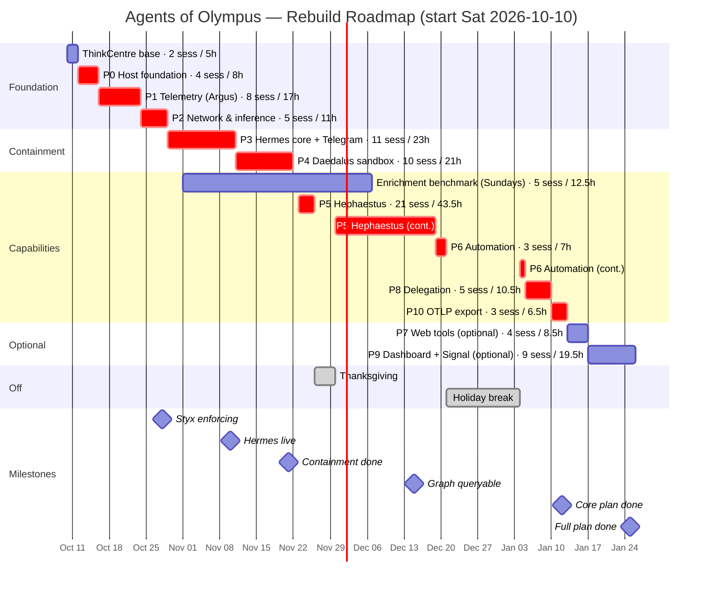

# Agents of Olympus — Rebuild Roadmap

**Start:** Sat Oct 10, 2026 · **Cadence:** 2 h weekdays, 2.5 h weekends (15.5 h/week, every day) · **Off:** Nov 26–29, Dec 21–Jan 3

**Core plan (P0–P6, P8, P10):** 77 sessions · 165 h · done **Tue Jan 12, 2027**  
**Full plan (+ P7, P9):** 90 sessions · 193 h · done **Mon Jan 25, 2027**

## Roadmap

| Milestone | Date | Meaning |
|---|---|---|
| Styx enforcing | Wed Oct 28, 2026 | All egress forced through per-source allowlists |
| Hermes live | Tue Nov 10, 2026 | Hermes on Telegram with P3 gates passed |
| Containment done | Sat Nov 21, 2026 | Shell runs in Daedalus; exfil gates passed |
| Graph queryable | Tue Dec 15, 2026 | Hephaestus gates passed |
| Core plan done | Tue Jan 12, 2027 | P10 gate passed |
| Full plan done | Mon Jan 25, 2027 | Optional P7 + P9 complete |

> **Schedule risk:** zero slack. Any missed session shifts everything after it. The biggest single risk is the P4 file-tool location check — if file tools act on the Hermes container rather than Daedalus, P4 and later shift 1–2 weeks.

## Checklists

Each box is one session. Gate tests pass only when the control held **and** the attempt was visible in Loki/alerts.

### ThinkCentre base

*Sat Oct 10 → Sun Oct 11 · 2 sessions · 5 h*

- [X] `2026-10-10` (2.5h) — ThinkCentre: Ubuntu + LUKS install
- [X] `2026-10-11` (2.5h) — ThinkCentre: Tailscale join, SSH hardening, updates

**Exit criteria:** ThinkCentre is LUKS-encrypted, on the tailnet, SSH key-only, and patched.

### P0 Host foundation

*Mon Oct 12 → Thu Oct 15 · 4 sessions · 8 h*

- [ ] `2026-10-12` (2h) — Create LVs: Docker, containerd, models, /opt/data, repos
- [ ] `2026-10-13` (2h) — Delete old volumes; relocate Docker/containerd data-root
- [ ] `2026-10-14` (2h) — Hades: per-host age keys, .sops.yaml recipients, repo layout
- [ ] `2026-10-15` (2h) — Revoke OpenClaw creds; dedicated Anthropic key + spend limit; P0 gate

**Exit criteria:** OpenClaw credentials confirmed revoked; dedicated Anthropic key has a verified spend limit; age keys are per-host and root-only.

### P1 Telemetry (Argus)

*Fri Oct 16 → Fri Oct 23 · 8 sessions · 17 h*

- [ ] `2026-10-16` (2h) — Tailscale ACLs: Beelink→ingest ports only; no reverse path
- [ ] `2026-10-17` (2.5h) — Loki (upgraded), 90-day security retention
- [ ] `2026-10-18` (2.5h) — Prometheus remote-write receiver; Grafana tailnet-only
- [ ] `2026-10-19` (2h) — Alloy on Beelink: journald + Docker logs from disk
- [ ] `2026-10-20` (2h) — auditd rules on /opt/data persistence surfaces → Alloy
- [ ] `2026-10-21` (2h) — Alert bot (ThinkCentre-only token) + priority-signal rules
- [ ] `2026-10-22` (2h) — Dead-man's switch (absent_over_time) + external heartbeat
- [ ] `2026-10-23` (2h) — **GATE T-OBS-1 + fixes**

**Exit criteria:** T-OBS-1 passes: a test event on the Beelink reaches Loki, alerts reach Nelson via the ThinkCentre-only bot, and the dead-man's switch fires when Alloy stops.

### P2 Network & inference

*Sat Oct 24 → Wed Oct 28 · 5 sessions · 11 h*

- [ ] `2026-10-24` (2.5h) — Docker networks: egress-hermes, egress-exec, net-model, net-exec
- [ ] `2026-10-25` (2.5h) — Styx per-source SNI allowlists
- [ ] `2026-10-26` (2h) — Styx denies: RFC1918, link-local, CGNAT, IP-literal/no-SNI; DNS/DoH
- [ ] `2026-10-27` (2h) — Pythia on net-model, no egress; out-of-band model pulls
- [ ] `2026-10-28` (2h) — Retire Cerberus; Styx-deny alerts in Loki; GATE Doc 03 checks

**Exit criteria:** Doc 03 checks pass: every agent network's egress is limited to its allowlist (Daedalus: empty), denies are logged, Pythia has no route out.

### P3 Hermes core + Telegram

*Thu Oct 29 → Tue Nov 10 · 11 sessions · 23 h*

- [ ] `2026-10-29` (2h) — Research backlog: read-only config vs Managed Scope; file-tool + execute_code location (source reading)
- [ ] `2026-10-30` (2h) — Hermes container: digest pin, UID 10000, /opt/data, secrets as files
- [ ] `2026-10-31` (2.5h) — config.yaml hardening: approvals, security keys, toolsets off
- [ ] `2026-11-02` (2h) — Read-only mounts: config.yaml, hooks/, SOUL.md; hermes doctor
- [ ] `2026-11-03` (2h) — Telegram bot: DM, allowlists, unauthorized_dm_behavior ignore
- [ ] `2026-11-04` (2h) — Forum group + topics; privacy mode check; disable joins
- [ ] `2026-11-05` (2h) — Token-spend telemetry source; Hermes logs → Loki
- [ ] `2026-11-06` (2h) — Canary planting + injection test harness
- [ ] `2026-11-07` (2.5h) — **GATE T-AUTH-1, T-MEM-1**
- [ ] `2026-11-09` (2h) — **GATE T-SKILL-1, T-APPROVE-1**
- [ ] `2026-11-10` (2h) — **GATE T-OBS-2 + fixes**

**Exit criteria:** T-AUTH-1, T-MEM-1, T-SKILL-1, T-APPROVE-1, T-OBS-2 all pass — control held AND attempt visible in Loki/alerts.

### Enrichment benchmark (Sundays)

*Sun Nov 1 → Sun Dec 6 · 5 sessions · 12.5 h*

- [ ] `2026-11-01` (2.5h) — Benchmark harness: JSON schema, scoring, clean corpus
- [ ] `2026-11-08` (2.5h) — Benchmark: adversarial corpus (injection in comments/docstrings)
- [ ] `2026-11-15` (2.5h) — Benchmark: review overnight runs, round 1
- [ ] `2026-11-22` (2.5h) — Benchmark: review overnight runs, round 2
- [ ] `2026-12-06` (2.5h) — Benchmark: decision write-up (closes open decision #1)

**Exit criteria:** Open decision #1 is closed with a written model choice (schema validity, latency, injection resistance).

### P4 Daedalus sandbox

*Wed Nov 11 → Sat Nov 21 · 10 sessions · 21 h*

- [ ] `2026-11-11` (2h) — Daedalus image: minimal sshd, capability set, non-root, no secrets
- [ ] `2026-11-12` (2h) — SSH key auth from Hermes over net-exec; empty egress
- [ ] `2026-11-13` (2h) — terminal.backend: ssh; smoke tests
- [ ] `2026-11-14` (2.5h) — Verify file-tool / execute_code location empirically
- [ ] `2026-11-16` (2h) — Resource limits, read-only rootfs, tmpfs
- [ ] `2026-11-17` (2h) — Alerts: docker exec, new containers, OOM for Daedalus
- [ ] `2026-11-18` (2h) — **GATE T-EXFIL-1**
- [ ] `2026-11-19` (2h) — **GATE T-EXFIL-2**
- [ ] `2026-11-20` (2h) — **GATE T-EXFIL-3**
- [ ] `2026-11-21` (2.5h) — **GATE T-SECRET-1 + fixes**

**Exit criteria:** T-EXFIL-1..3 and T-SECRET-1 pass; file-tool / execute_code location is verified, not assumed.

### P5 Hephaestus

*Mon Nov 23 → Fri Dec 18 · 21 sessions · 43.5 h*

- [ ] `2026-11-23` (2h) — MCP server skeleton: container, HTTP transport, bearer auth
- [ ] `2026-11-24` (2h) — Include-list 3 tools; resources/prompts off; sampling disabled
- [ ] `2026-11-25` (2h) — Repos LV read-only; identifier (not path) resolution
- [ ] `2026-11-30` (2h) — tree-sitter parsing: language set + tiered fallback
- [ ] `2026-12-01` (2h) — tree-sitter parsing: finish + unit tests
- [ ] `2026-12-02` (2h) — Graph schema + storage (Hephaestus-owned, not mounted in Hermes)
- [ ] `2026-12-03` (2h) — Tool: index_repo
- [ ] `2026-12-04` (2h) — Tool: query_graph
- [ ] `2026-12-05` (2.5h) — Tool: get_symbol
- [ ] `2026-12-07` (2h) — Enrichment: prompt + Ollama structured outputs
- [ ] `2026-12-08` (2h) — Enrichment: validate-before-write
- [ ] `2026-12-09` (2h) — Provenance tags + heuristic instruction stripping
- [ ] `2026-12-10` (2h) — Output limits: no bulk raw repo text to Hermes
- [ ] `2026-12-11` (2h) — Enrichment-rejection metrics → Loki
- [ ] `2026-12-12` (2.5h) — Register MCP in Hermes; end-to-end from Hermes
- [ ] `2026-12-13` (2.5h) — Poisoned-repo test corpus
- [ ] `2026-12-14` (2h) — **GATE T-MCP-1**
- [ ] `2026-12-15` (2h) — **GATE T-GRAPH-1**
- [ ] `2026-12-16` (2h) — Fixes / hardening (1)
- [ ] `2026-12-17` (2h) — Fixes / hardening (2)
- [ ] `2026-12-18` (2h) — Runbook + context-file update

**Exit criteria:** T-MCP-1 and T-GRAPH-1 pass against the poisoned-repo corpus; no raw bulk repo text reaches Hermes.

### P6 Automation

*Sat Dec 19 → Mon Jan 4 · 3 sessions · 7 h*

- [ ] `2026-12-19` (2.5h) — cronjob config; deliver: to forum topics
- [ ] `2026-12-20` (2.5h) — Verify cron_mode deny interplay + output hygiene
- [ ] `2027-01-04` (2h) — **GATE T-CRON-1**

**Exit criteria:** T-CRON-1 passes; cron output lands only in the intended forum topics.

### P8 Delegation

*Tue Jan 5 → Sat Jan 9 · 5 sessions · 10.5 h*

- [ ] `2027-01-05` (2h) — Delegation: provider → Pythia
- [ ] `2027-01-06` (2h) — Limits: max_concurrent_children 2, spawn depth 1, orchestrator off
- [ ] `2027-01-07` (2h) — Verify child toolsets and message restrictions
- [ ] `2027-01-08` (2h) — **GATE T-DELEG-1**
- [ ] `2027-01-09` (2.5h) — Fixes

**Exit criteria:** T-DELEG-1 passes; children run on Pythia with depth 1, concurrency 2, no messaging.

### P10 OTLP export

*Sun Jan 10 → Tue Jan 12 · 3 sessions · 6.5 h*

- [ ] `2027-01-10` (2.5h) — Decide Alloy OTLP receiver placement (backlog item)
- [ ] `2027-01-11` (2h) — net-telemetry + Hermes OTLP export, self-report label
- [ ] `2027-01-12` (2h) — Silent-export alert; GATE T-OTLP-1

**Exit criteria:** T-OTLP-1 passes; the silent-export alert fires when Hermes export stops while the host is healthy.

### P7 Web tools (optional)

*Wed Jan 13 → Sat Jan 16 · 4 sessions · 8.5 h*

- [ ] `2027-01-13` (2h) — Choose search/extract provider; exfil analysis of its domain
- [ ] `2027-01-14` (2h) — Styx allowlist + Hermes web config
- [ ] `2027-01-15` (2h) — **GATE T-WEB-1**
- [ ] `2027-01-16` (2.5h) — Fixes

**Exit criteria:** T-WEB-1 passes; the provider domain's write/exfil surface is documented and accepted.

### P9 Dashboard + Signal (optional)

*Sun Jan 17 → Mon Jan 25 · 9 sessions · 19.5 h*

- [ ] `2027-01-17` (2.5h) — Dashboard: loopback bind, SSH tunnel over Tailscale
- [ ] `2027-01-18` (2h) — **GATE T-DASH-1**
- [ ] `2027-01-19` (2h) — Signal: dedicated number, signal-cli, Registration Lock
- [ ] `2027-01-20` (2h) — Signal groups per update stream
- [ ] `2027-01-21` (2h) — Signal deliver: syntax; migrate cron targets
- [ ] `2027-01-22` (2h) — Signal gate tests (auth/approval parity)
- [ ] `2027-01-23` (2.5h) — Cutover; revoke Telegram bot tokens
- [ ] `2027-01-24` (2.5h) — ntfy for alerts
- [ ] `2027-01-25` (2h) — Context-file + runbook update

**Exit criteria:** T-DASH-1 and Signal parity tests pass; Telegram bot tokens revoked after cutover.